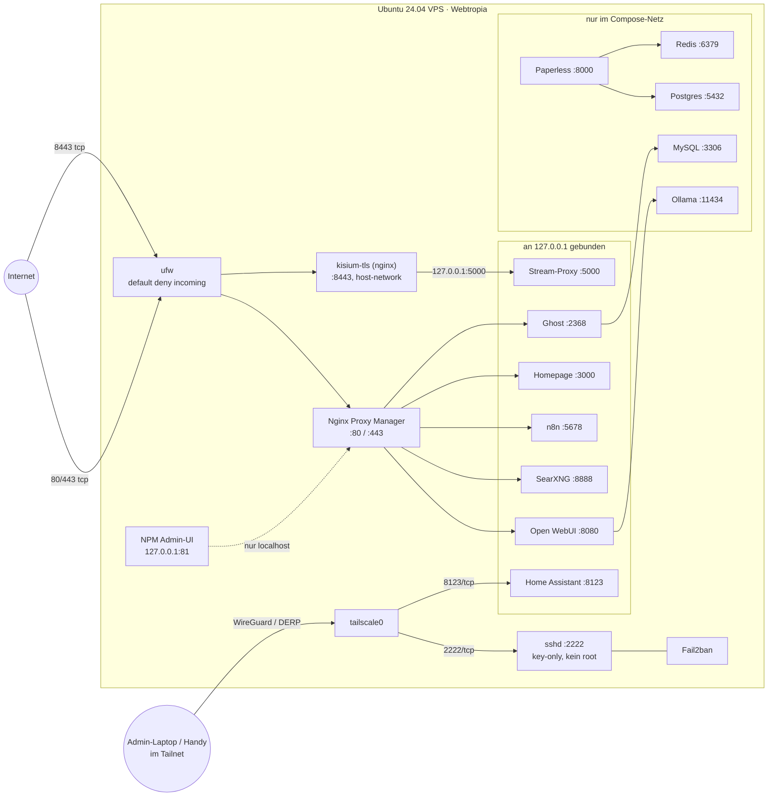

# Ubuntu-24.04-VPS mit Ansible provisionieren

Ein-Host-Provisionierung fuer einen Ubuntu-24.04-VPS (Webtropia): Hardening, Docker,
15 Container in fuenf Compose-Projekten, Tailscale, Fail2ban, unattended-upgrades.
Lizenz: [MIT](LICENSE) · Pruefungen: `.github/workflows/ci.yml`
(ansible-lint, yamllint, shellcheck).

## 1. Was das hier ist

Dieses Repository provisioniert einen VPS (Webtropia, Ubuntu 24.04.5 LTS) per Ansible
von null auf produktiv: Hardening (ufw, SSH, Fail2ban, unattended-upgrades),
Tailscale-Zugang, Docker und 15 Container in fuenf Compose-Projekten hinter einem
Nginx Proxy Manager.
Ein frisch installierter VPS steht damit in **ca. 20-30 Minuten** (Schaetzung:
dominiert von `apt` und Image-Pulls); ein zweiter Lauf gegen denselben Host braucht
**101 Sekunden** (gemessen am 08.11.2026).
Der Plattform-Teil (`base`, `tailscale`, `ssh`, `ufw`, `fail2ban`) laeuft auf einer
frischen Ubuntu-24.04-VM in **82 Sekunden**, der zweite Lauf in **34 Sekunden ohne
Aenderung** - reproduzierbar mit `scripts/test-vm.sh`.
Ausdruecklich **nicht** abgedeckt: Hochverfuegbarkeit/Failover, zentrale Logs und
Metriken, Multi-Host-Orchestrierung, automatisierte Backup-Restore-Tests und die
DNS-/Domain-Verwaltung.

## 2. Architektur



Zwei Wege: **oeffentlich** sind 80/443/tcp (NPM) und 8443/tcp (`kisium-tls`),
**Admin** laeuft ueber `tailscale0` auf 2222/tcp und 8123/tcp. `41641/udp` ist
absichtlich geschlossen - Tailscale baut die Verbindung bei Bedarf ueber
DERP-Relais auf; eine Portfreigabe ist fuer NAT-Traversal nicht erforderlich
(siehe Abschnitt 5).

### Ports und Bindings (Stand: laufender Host)

| Dienst | Port | Binding | Erreichbar ueber |
| --- | --- | --- | --- |
| Nginx Proxy Manager | 80, 443 | `0.0.0.0` | Internet |
| `kisium-tls` (nginx) | 8443 | host-network | Internet |
| NPM Admin-UI | 81 | `127.0.0.1` | SSH-Tunnel |
| Open WebUI | 8080 | `127.0.0.1` | NPM |
| SearXNG | 8888 | `127.0.0.1` | NPM |
| n8n | 5678 | `127.0.0.1` | NPM |
| Homepage | 3000 | `127.0.0.1` | NPM |
| Ghost (Kisium) | 2368 | `127.0.0.1` | NPM |
| Stream-Proxy | 5000 | `127.0.0.1` | `kisium-tls` |
| Home Assistant | 8123 | `127.0.0.1` + `tailscale0` | NPM, Tailnet |
| Paperless-ngx | 8000 | Compose-Netz | NPM (intern) |
| Ollama | 11434 | Compose-Netz | Open WebUI |
| MySQL / Postgres / Redis | 3306 / 5432 / 6379 | Compose-Netz | nur eigener Stack |
| sshd | 2222 | `0.0.0.0`, ufw nur `tailscale0` | Tailnet |

## 3. Quickstart

```bash
pipx install ansible-core && ansible-galaxy collection install -r requirements.yml
cp hosts.ini.example hosts.ini      # Tailscale-IP, Port und Key-Pfad eintragen
ansible-playbook site.yml --ask-vault-pass -K
```

Voraussetzungen: Tailscale auf dem Client aktiv, ein Key-Paar fuer `admin`,
Vault-Passwort im Password-Manager, und der VPS ist bereits im Tailnet. Der
Tailnet-Beitritt des VPS ist ein manueller Einmal-Schritt (`tailscale up`):
ein Authkey gehoert nicht ins Repo und nicht in die CI.
Erster Lauf immer als Dry-Run:
`ansible-playbook site.yml --check --diff --ask-vault-pass -K`.

Lint und Syntax-Check lokal wie in der CI: `make check` (legt `hosts.ini` bei
Bedarf aus der Vorlage an). Secret-Vorpruefung vor jedem Push: `make audit`.

## 4. Rollen

Die Reihenfolge in der Tabelle ist die Ausfuehrungsreihenfolge; sie steht auch
so als Kommentar in `site.yml`.

| Rolle | Zweck | Tags |
| --- | --- | --- |
| `base` | apt-Update, Grundpakete, Zeitzone, unattended-upgrades | `base`, `packages`, `updates` |
| `tailscale` | Tailnet-Beitritt, Authkey aus dem Vault | `tailscale`, `vpn` |
| `ssh` | sshd auf 2222, key-only, `PermitRootLogin no`, `AllowUsers admin` | `ssh`, `hardening` |
| `ufw` | deny incoming; 80/443, 8443 public; 2222 nur `tailscale0` | `ufw`, `firewall`, `hardening` |
| `fail2ban` | Jail fuer sshd (systemd-Backend) | `fail2ban`, `hardening` |
| `docker` | Docker Engine + Compose-Plugin, Daemon-Haertung | `docker` |
| `stack_kisium` | Ghost + MySQL, legt das Netz `kisium-net` an | `kisium`, `stacks` |
| `stack_homeserver` | NPM, Open WebUI, Ollama, SearXNG, n8n, Paperless (+ Postgres, Redis) | `homeserver`, `stacks` |
| `stack_homepage` | Homepage-Dashboard | `homepage`, `stacks` |
| `stack_homeassistant` | Home Assistant, 8123 auf Loopback und `tailscale0` | `homeassistant`, `stacks` |
| `stack_kisium_tv` | Stream-Proxy, Catalog-Sync, TLS-Terminator auf 8443 | `kisium_tv`, `stacks` |

Warum diese Reihenfolge:

- **Tailscale vor ssh/ufw** - sonst gibt es nach dem Umschalten keinen zweiten
  Weg mehr auf den Host. Innerhalb der ufw-Rolle muss die Regel fuer 2222 auf
  `tailscale0` stehen, bevor `ufw` aktiviert wird.
- **`stack_kisium` vor `stack_homeserver`** - der homeserver-Stack haengt sich
  als externes Netz an `kisium-net`, das der kisium-Stack erzeugt.
- **`stack_homeserver` vor Homepage und Home Assistant** - beide nutzen das Netz
  `homeserver_default`.

Tags erlauben gezielte Laeufe: `ansible-playbook site.yml --tags stacks --ask-vault-pass`
provisioniert nur die Compose-Stacks neu, `--tags hardening` nur SSH/ufw/Fail2ban.

## 5. Sicherheitsentscheidungen

### SSH ausschliesslich ueber Tailscale

- **Was:** sshd lauscht auf 2222, ufw erlaubt 2222/tcp nur `in on tailscale0`.
  `PasswordAuthentication no`, `PermitRootLogin no`, nur Pubkey, `MaxAuthTries 6`.
- **Warum:** Der Port existiert im oeffentlichen Scan nicht. Tailscale authentifiziert
  per WireGuard-Key und Tailnet-ACL, bevor ueberhaupt eine TCP-Verbindung zustande
  kommt - die gesamte Klasse "Scanner und Passwort-Bots" faellt weg, ohne dass
  Fail2ban die einzige Verteidigung ist.
- **Was ich dafuer aufgegeben habe:** Kein SSH ohne laufendes Tailscale auf dem Client.
  Faellt die Control Plane aus, bleibt nur die Webtropia-Konsole als Out-of-Band-Weg -
  deshalb ist der Tailnet-Lockout kein Totalverlust, aber ein Umweg.
- **Zusaetzlich:** `AllowUsers admin` ist gesetzt - nur der Admin-Account darf sich
  anmelden, auch wenn weitere Keys hinterlegt waeren.

### ufw default deny incoming

- **Was:** `default deny incoming`, `default allow outgoing`. Oeffentlich sind genau
  drei Ports: 80/443/tcp (NPM), 8443/tcp (`kisium-tls`) und 2222/tcp nur auf
  `tailscale0`.
- **Warum:** Whitelist statt Blacklist. Ein neuer Dienst ist erst einmal zu, auch wenn
  er versehentlich startet.
- **Was ich dafuer aufgegeben habe:** Jeder neue Port braucht eine Regel und einen
  Deploy. "Mal schnell was testen" geht nicht mehr ohne Config-Aenderung - was genau
  der Zweck ist.

### Kein 41641/udp

- **Was:** keine ufw-Regel fuer 41641/udp. Tailscale nutzt bei Bedarf DERP-Relais
  statt eines direkten Pfads.
- **Warum:** Ein offener UDP-Port ist Angriffsflaeche fuer Scanning und Amplification
  und bringt fuer einen einzelnen Admin-Zugang nur Latenz-Gewinn. Fuer SSH reicht
  DERP. **Bewusste Entscheidung, kein Bug.**
- **Was ich dafuer aufgegeben habe:** Hoehere Latenz bei Admin-Sessions und langsameres
  `scp`/`rsync` ueber Tailscale, weil der direkte Pfad fehlt.

### Docker-Bindings an 127.0.0.1

- **Was:** Portveroeffentlichungen werden an `127.0.0.1` gebunden. Zwei bewusste
  Ausnahmen sind unten separat begruendet: Home Assistant auf `tailscale0` und
  `kisium-tls` mit `network: host` auf 8443.
- **Warum:** Docker schreibt eigene iptables-Regeln (`nat`, `DOCKER-USER`) und laeuft
  an ufw vorbei - ein `-p 8080:8080` waere trotz `deny incoming` oeffentlich
  erreichbar. Die Loopback-Bindung ist die einzige verlaessliche Grenze, ufw ist nur
  die zweite Linie.
- **Was ich dafuer aufgegeben habe:** Kein direkter Zugriff auf App-Ports aus dem LAN.
  Debugging nur ueber `ssh -L` oder eine NPM-Route; jede zusaetzliche Portfreigabe ist
  eine bewusste Einzelentscheidung.

### NPM-Admin nur auf 127.0.0.1:81

- **Was:** Admin-UI an `127.0.0.1:81`, Zugriff ausschliesslich per SSH-Tunnel.
- **Warum:** Der NPM-Admin ist root-aequivalent fuer alle vhosts und TLS-Zertifikate.
  Basic-Auth im Web waere kein Ersatz, sondern nur eine zusaetzliche Huerde vor
  derselben Angriffsflaeche.
- **Was ich dafuer aufgegeben habe:** Bequemlichkeit - jeder Admin-Zugriff auf die
  Proxy-Konfiguration braucht einen Tunnel.

### Datenbanken ohne oeffentlichen Port

- **Was:** MySQL, Postgres und Redis haben kein `ports:`-Mapping und sind nur ueber
  das Compose-Netz ihres Stacks erreichbar.
- **Warum:** DB-Ports sind die haeufigsten automatisierten Angriffsziele
  (unauthentifiziertes Redis, Postgres-Brute-Force). Was keinen Host-Port hat, ist
  nicht scanbar.
- **Was ich dafuer aufgegeben habe:** Kein externer DB-Client ohne `docker exec` oder
  SSH-Tunnel; Migrationen laufen im Container.

### 8443/tcp oeffentlich fuer den Kisium-Stream

- **Was:** `kisium-tls` (nginx:alpine) laeuft mit `network: host`, terminiert TLS auf
  8443 und proxyt auf den Stream-Proxy an `127.0.0.1:5000`. ufw erlaubt 8443/tcp.
- **Warum:** Der Stream braucht einen eigenen TLS-Endpunkt mit eigenem Zertifikat;
  ueber NPM davor waere es doppeltes Proxying mit einem zweiten Hop fuer Videodaten.
  Host-Network ist noetig, weil der Container den Port selbst binden muss.
- **Was ich dafuer aufgegeben habe:** Ein zweiter oeffentlicher Port neben 80/443,
  ein zweiter Zertifikats-Renewal-Pfad, und der Container entkommt der
  Docker-Netz-Isolation - er sieht alle Host-Interfaces, nicht nur sein Bridge-Netz.

### Home Assistant auf `tailscale0`

- **Was:** 8123/tcp ist an `127.0.0.1` **und** an die Tailscale-Adresse gebunden.
- **Warum:** Handy und Tablet greifen direkt aus dem Tailnet zu, ohne oeffentliche
  Freigabe und ohne NPM-Route. Der Port ist im Internet nicht erreichbar.
- **Was ich dafuer aufgegeben habe:** Jedes Geraet im Tailnet erreicht Home Assistant
  ohne vorgelagerte Authentifizierung; Zugriffslogs und TLS liegen nicht beim NPM.

### `no-new-privileges` + `cap_drop: ALL`

- **Was:** `security_opt: ["no-new-privileges:true"]`, `cap_drop: ["ALL"]`, nur
  benoetigte Capabilities per `cap_add` zurueck.
- **Warum:** Setuid-Binaries und privilegierte Helper koennen im Container keine Rechte
  nachtraeglich erhoehen. Ein Container-Escape braucht damit mehr als einen einzelnen
  Bug.
- **Was ich dafuer aufgegeben habe:** Einige Images brauchen explizit Caps
  (z. B. `NET_BIND_SERVICE`, `CHOWN`) und brechen ohne sie still - das kostet
  Debug-Zeit pro Stack.

## 6. Bewusste Einschraenkungen

- **Plattform ist Ubuntu 24.04 LTS, nicht Debian 12:** Das Webtropia-Image ist Ubuntu
  24.04.5. Die Rollen nutzen nur `apt` und `systemd` und sollten auf Debian 12
  laufen - getestet ist das nicht.
- **Single-Host:** Ein VPS, kein zweiter Node. Deploys sind alles-oder-nichts, kein
  Rolling Update; ein Reboot bedeutet Downtime.
- **Kein HA:** NPM, die Datenbanken und Tailscale sind Single Points of Failure. Die
  Wiederherstellungszeit ist die Zeit fuer einen Neuaufbau aus diesem Repo - genau
  dafuer ist es da.
- **Kein zentrales Logging:** Logs bleiben in journald und in den Containern
  (`journalctl`, `docker logs`). Keine Suche ueber Zeit, keine Historie, Forensik nach
  einem Incident ist muehsam.
- **Monitoring ist ein Skript, kein Stack:** `health-check.sh` prueft stuendlich
  Zertifikatslaufzeiten, Container-Health, Reboot-Bedarf und Disk-Auslastung. Alarmiert
  wird nach dem Dead-Man-Prinzip: der taegliche Restore-Test pingt healthchecks.io,
  bleibt der Ping aus, kommt die Mail. Dazu ein Boot-Check, der nach einem Neustart
  zaehlt, ob alle Container zurueckkommen, und ein **deaktiviertes** Reboot-Fenster
  (`reboot-window.sh`) - die Entscheidung, wann neu gestartet wird, bleibt manuell.
  Keine Metriken, keine Dashboards, kein Verlauf.
- **NPM braucht root fuer 80/443:** Privilegierte Ports. Die Alternative
  (`CAP_NET_BIND_SERVICE` plus Socket-Activation) wuerde Certbot-Hooks und das
  Container-Setup mit Sonderfaellen belasten - bewusst nicht umgesetzt.
- **Backups liegen lokal:** taeglich nach `/opt/backups` (paperless 03:30, n8n/HA/
  Konfiguration 02:45, kisium 03:00, Restore-Test 04:00). Ein Offsite-Ziel ist
  vorbereitet (`restic-offsite.sh`), aber noch nicht konfiguriert - stirbt die Disk,
  ist alles weg. TODO: `RESTIC_REPOSITORY` setzen.
- **Secrets nur per Vault:** keine Anbindung an einen externen Secret-Store (kein
  SOPS, kein Vault-Server). Das Vault-Passwort liegt im Password-Manager, Rotation ist
  ein manueller Schritt.
- **Keine Molecule-Tests:** Rollen werden nicht in Containern getestet. Die CI prueft
  Syntax und Lint, nicht das Verhalten der Rollen - ein Rollen-Regressionscheck fehlt
  damit komplett.

## 7. Was ich dabei gelernt habe

**1. ufw hat die Docker-Ports nicht geschlossen.**
Fehler: `ufw status` meldete "sauber", `nmap` von aussen fand trotzdem offene
App-Ports.
Ursache: Docker schreibt eigene iptables-Regeln und laeuft an ufw vorbei - die
Firewall war die falsche Ebene fuer dieses Problem.
Fix: Alle Veroeffentlichungen auf `127.0.0.1:` gebunden und von aussen gegengeprueft.
ufw ist jetzt die zweite Linie, nicht die einzige.

**2. Aussperrung nach der SSH-Umstellung.**
Fehler: Nach dem Wechsel auf Port 2222 und einem ufw-Reload im selben Lauf war die
Session tot und niemand kam mehr rein.
Ursache: Portaenderung, Firewall-Regel und Reload in einem Schritt, ohne zweiten
offenen Zugang als Kontrolle.
Fix: Aenderungen an sshd und ufw laufen in getrennten Laeufen, `sshd -t` vor jedem
Reload, zweite Session bleibt offen, Out-of-Band-Weg (Webtropia-Konsole) ist
dokumentiert.

**3. Fail2ban blieb stumm und meldete trotzdem "active".**
Fehler: Nach Fehlversuchen tauchte kein Ban auf, `systemctl status fail2ban` war gruen.
Ursache: Der sshd-Jail lauschte auf Port 22, sshd laeuft aber auf 2222 - der Filter
hat nie einen Treffer gesehen.
Fix: `port = 2222` (bzw. `backend = systemd`) und ein bewusster Fehlversuch als
Funktionstest, statt sich auf den gruenen Status zu verlassen.

**4. Eine manuell gesetzte Netzwerk-Anbindung verschwand beim `compose up`.**
Fehler: Nach dem Neustart von n8n lag der Container nur noch im Standardnetz; die
zuvor von Hand gesetzte Verbindung zu `kisium-net` (MySQL, Ghost) war weg. Workflows
mit DB-Zugriff waeren still gescheitert - kein Fehler im Log, nur ein Timeout.
Ursache: `docker network connect` ist Laufzeitzustand. Jedes `up -d` setzt die Netze
auf das zurueck, was in der Compose-Datei steht.
Fix: Netzzugehoerigkeit deklarativ in `docker-compose.override.yml` eingetragen und
nach jedem Recreate mit `docker inspect -f '{{range $k,$v := .NetworkSettings.Networks}}{{$k}} {{end}}'`
gegengeprueft.

## 8. Vor dem Umschalten auf public

- [ ] **Historie:** `make audit` und `gitleaks`/`trufflehog` ohne Findings, kein
      `hosts.ini`, keine Tailscale-IP, keine echte Domain in `git log -p`. Sonst
      `git filter-repo` oder frischer Initial-Commit (siehe `SECRETS-AUDIT.md`).
- [ ] **GitHub-Settings:** Repo privat anlegen, pushen, erst dann public. Secret
      Scanning + Push Protection aktiv, Branch Protection fuer `main` (PR + gruene CI),
      Force-Push aus.
- [ ] **Links:** README-Links klickbar, Mermaid rendert, Screenshots ohne echte Domains,
      IPs oder Logzeilen, keine Links auf private Repos.
- [x] **Lizenz:** `LICENSE` (MIT, Copyright Tobias Peine) liegt bei und ist oben im
      README genannt.
- [ ] **Kontaktdaten:** Commit-Mails auf `...@users.noreply.github.com` umgestellt,
      Kontaktweg im Profil statt privater Mailadresse im Repo.

<!-- TODO: Screenshot von NPM/Homepage ohne Domain und ohne IP einbetten. -->
